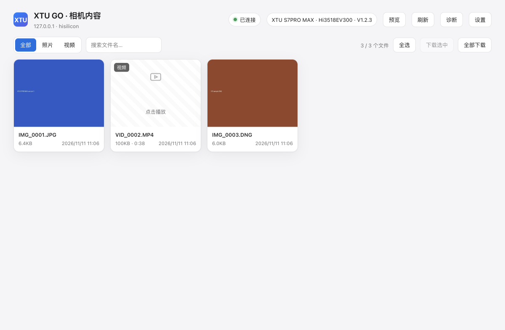

# XTU GO 相机 macOS 客户端

把 **XTU GO（骁途 / GKU，`com.gku.xtugo`）** 运动相机里的照片、视频，直接从相机的 Wi-Fi
拉到 Mac：一个本地 Web UI + 一个命令行工具，**纯 Python 标准库，零依赖**。



> 协议来自 Android 版 XTU GO 8.5.3 的静态逆向（[分析笔记](ANALYSIS.md)）。
> 相机不经过云、也不走 P2P —— 它本身就是一台 Wi-Fi AP + HTTP/TCP 服务器，
> 官方 App 也是这么连的，所以 Mac 完全可以自己实现。

## 快速开始

```bash
git clone https://github.com/duceman495/xtugo-mac.git
cd xtugo-mac

# 1) 让 Mac 连上相机 Wi-Fi（相机开机后一般是 AP 模式）
#    SSID 常见以 XTU / YUTU / 3516A / himc 开头，默认密码 12345678

# 2) 启动 Web UI（会自动开浏览器）
./run-webui.command
#    → http://127.0.0.1:8765
```

需要一个 Python 3.9+（macOS 自带就够）。

### 命令行也行

```bash
python3 xtu.py info            # 识别相机：型号 / 芯片 / 固件
python3 xtu.py ls              # 列 SD 卡上的照片和视频
python3 xtu.py get all         # 全部下载到 ./xtu-download
python3 xtu.py --dest ~/Pictures/xtu get 0
python3 xtu.py preview         # 打印 RTSP 预览地址
```

自动探测顺序：Wi-Fi 接口的 DHCP 路由器 → `192.168.0.1` → `192.168.1.1` → `192.168.42.1`。
相机不在这些地址时用 `python3 xtu.py --host 192.168.0.1 ...`。

## 能做什么

| | |
|---|---|
| 浏览 | 缩略图网格、照片/视频筛选、文件名搜索、按时间排序（相机返回顺序） |
| 预览 | 点开看大图；视频直接在浏览器里播（相机不支持 Range，只能顺序播） |
| 下载 | 单个 / 勾选多个 / 全部；下载前先握手确认，失败会在页面里说明原因 |
| 状态 | 相机型号、芯片、固件、SD 卡、电量；当前 Wi-Fi 与网关 |
| 诊断 | 一键跑「探测 → 列表 → 8080 → HTTP → 取文件」，哪步红的就是哪步的问题 |
| 实时画面 | 复制 `rtsp://相机:554/livestream/12`，用 IINA / ffplay 打开 |

服务只监听 `127.0.0.1`，所有相机请求都由本机进程代理，所以浏览器没有跨域/混合内容问题。

## 它是怎么工作的

| 环节 | 协议 |
|---|---|
| 识别 | `GET /cgi-bin/hi3510/getdeviceattr.cgi` → `var name="…"; var type="…"` |
| 计数 | `getfilecount.cgi`（HiSilicon）/ `getfiletypecount.cgi`（SigmaStar） |
| 列表 | `getfilelistinfoios.cgi?-start=&-end=` → JSON（`path/size/create/time`） |
| 下载 | **TCP 8080 私有协议**（与官方 App 相同）；失败再试 HTTP |
| 预览 | `rtsp://相机:554/livestream/12`（`/11` 大码流） |

### 8080 私有协议

```
请求 72 字节（小端）
  int32   0            固定 0 = GET_FILE
  int32   len          路径字节数
  byte[64] path        UTF-8，右补 \0（路径不能超过 64 字节）

应答 72 字节（小端）
  int32   cmd          0 = 成功
  uint32  length       文件字节数
随后是 length 字节裸数据
```

### 路径是相对的

这台相机返回的是 `sd/DCIM/100XTUDV/NORM0006.MP4`（没有前导 `/`），
而它的 HTTP 服务又只接受带 `/` 的请求目标（`GET sd/…` 直接 400）。
所以两边都要试：socket 用原样，HTTP 用 `/sd/…`。

## 实测机型

**XTU S7PRO MAX**（`type=Hi3519DV500`，`soft=20.8.6.1.20261026.CN`）：

- 8080 通道：200 MB 的 4K 视频 **7 秒**拉完（≈28 MB/s）
- HTTP :80：带前导 `/` 才能取文件；:8080 是二进制协议，握手会重置
- RTSP 554 开放

### 已知限制

- **H.265**：相机若录 HEVC，Chrome 可能解不了，会提示"预览不了 → 下载这个文件"；
  下载后用 QuickTime / IINA 播放。
- **不能写入**：相机 SD 卡对 App 是只读的，本项目也没有实现固件推送（8080 `RECV_FILE`）。
- **Amba 家族**（H75N/CV75）走 7878 + 8787 双通道，尚未实现，列表可能为空。
- 只在上面那台机器上验证过；其他型号请先跑「诊断」。

## 目录结构

```
xtu.py                 # 协议实现 + 命令行
webui/server.py        # 本地 Web 服务（协议代理）
webui/static/index.html# 单文件前端
mock_camera.py         # 假相机：按同一协议实现，用于离线测试
run-webui.command      # 双击启动
docs/                  # 截图
ANALYSIS.md            # 逆向笔记：功能地图、协议细节、真机校正
```

## 排错

点右上角 **诊断**，它会依次输出：

```
getdeviceattr → getfilecount → getfilelistinfoios
→ 8080_connect → 8080_file → http_file :80 → http_file :8080 → fetch_file → rtsp_554
```

每步都有 `ok / ms / detail`。日志在 `~/.cache/xtu-webui/server.log`，
缩略图缓存在 `~/.cache/xtu-webui/thumbs/`（删掉可强制重建）。

## 免责声明

本项目是非官方的互操作性工具，与 XTU / 骁途 / 深圳市极酷威视科技有限公司无关。

- 不含任何官方 App 的代码、资源或固件，也不分发 APK；
- 协议信息来自对公开分发的 Android 应用做静态分析，仅用于让用户在自己的设备上
  取回自己拍摄的内容；
- 请只用于你有权访问的相机。按原样提供，不附带任何担保。

## License

[MIT](LICENSE)
